# Kubernetes from Scratch: a 3-Node kubeadm Cluster on RHEL

A hands-on lab where I built a Kubernetes cluster **by hand** with `kubeadm` on three RHEL virtual machines (KVM), then used it to learn the basics: deployments, scaling, services, rolling updates, rollbacks, troubleshooting broken pods, and node maintenance.

It's written for someone who knows Linux but is **new to Kubernetes**. Every step explains *what* it does and *why*.

> Built manually first on purpose. Doing every step by hand makes it clear what tools like Ansible, Kubespray or managed services (EKS) automate for you later.

---

## Table of contents

1. [Kubernetes in plain words](#1-kubernetes-in-plain-words)
2. [The lab setup](#2-the-lab-setup)
3. [Part 1: Build the cluster](#3-part-1-build-the-cluster)
4. [Part 2: Run an app on it](#4-part-2-run-an-app-on-it)
5. [Part 3: Break it and fix it](#5-part-3-break-it-and-fix-it)
6. [Part 4: Node maintenance](#6-part-4-node-maintenance)
7. [Problems I ran into](#7-problems-i-ran-into)
8. [Lab shortcuts vs production](#8-lab-shortcuts-vs-production)
9. [Command cheat sheet](#9-command-cheat-sheet)
10. [What's next](#10-whats-next)

---

## 1. Kubernetes in plain words

**Kubernetes** runs containers across a group of machines and keeps them running the way you asked. You don't start containers on servers yourself. You tell Kubernetes **what you want** ("3 copies of nginx"), and it decides **where** to run them, **watches** them, and **replaces** them if they die.

That idea is called **desired state**: you declare the goal, Kubernetes keeps working to match it. It's like Terraform, except Kubernetes keeps checking every few seconds, not only when you run `apply`.

### The pieces, compared to things a Linux admin already knows

| Kubernetes term | What it is | Linux / infra comparison |
|---|---|---|
| **Cluster** | All the machines working together as one pool | A volume group: several disks pooled into one |
| **Node** | One machine in the cluster (VM or physical) | A physical volume (one disk in the pool) |
| **Control plane** | The "brain": stores state, makes decisions | A management server |
| **Worker node** | The "muscle": runs your containers | The servers that actually run your apps |
| **Pod** | The smallest unit: one or more containers running together | A logical volume carved out of the pool |
| **Deployment** | "Keep N copies of this pod running, and update them safely" | A self-healing systemd service |
| **Service** | A stable name and IP in front of pods that keep changing | A built-in load balancer |
| **Namespace** | A way to separate groups of resources | Folders / tenants |
| **kubectl** | The command-line tool you use to talk to the cluster | Like `virsh` for libvirt |

### What runs where

| Component | Runs on | Job |
|---|---|---|
| `kube-apiserver` | Control plane | Front door. Everything (including `kubectl`) talks to it |
| `etcd` | Control plane | The cluster's database: stores the desired and current state |
| `kube-scheduler` | Control plane | Decides which worker each new pod goes to |
| `kube-controller-manager` | Control plane | Keeps reality matching the desired state (e.g. recreates dead pods) |
| `kubelet` | Every node | Agent that starts and watches pods on its node |
| `containerd` | Every node | The container runtime that actually runs containers |
| `kube-proxy` | Every node | Makes Services work by routing traffic to the right pods |
| `Flannel` (CNI) | Every node | Pod network: gives every pod an IP and lets pods on different nodes talk |
| `CoreDNS` | Inside the cluster | DNS so pods can find Services by name |

### How it fits together

```
                        Linux host (KVM / libvirt)
   +-----------------------------------------------------------------+
   |   libvirt network 192.168.122.0/24                              |
   |                                                                 |
   |   +----------------------+                                      |
   |   | k8s-cp01  .41        |  CONTROL PLANE                       |
   |   | apiserver, etcd,     |  (tainted: no normal workloads)      |
   |   | scheduler, ctrl-mgr  |                                      |
   |   +----------+-----------+                                      |
   |              |                                                  |
   |     +--------+---------+                                        |
   |     |                  |                                        |
   |  +--+------------+  +--+------------+                           |
   |  | k8s-w01  .42  |  | k8s-w02  .43  |   WORKERS                 |
   |  | pods:         |  | pods:         |                           |
   |  | 10.244.1.0/24 |  | 10.244.2.0/24 |                           |
   |  +---------------+  +---------------+                           |
   |        \_________ Flannel pod network _________/                |
   |                    (10.244.0.0/16)                              |
   +-----------------------------------------------------------------+
```

Each worker gets its own slice of the pod network (`10.244.1.x` on `k8s-w01`, `10.244.2.x` on `k8s-w02`), so you can tell which node a pod lives on just from its IP.

---

## 2. The lab setup

| VM | Role | IP | vCPU | RAM | Disk |
|---|---|---|---|---|---|
| `k8s-cp01` | Control plane | 192.168.122.41 | 2 | 3-4 GB | 30 GB |
| `k8s-w01` | Worker | 192.168.122.42 | 2 | 2 GB | 30 GB |
| `k8s-w02` | Worker | 192.168.122.43 | 2 | 2 GB | 30 GB |

- **OS:** RHEL 10, minimal install, default partitioning
- **Hypervisor:** KVM / libvirt on my Linux laptop, default NAT network
- **Kubernetes:** v1.34.13, installed with `kubeadm`
- **Container runtime:** containerd
- **Pod network (CNI):** Flannel, pod CIDR `10.244.0.0/16`

> `kubeadm` requires at least **2 vCPU and 2 GB RAM** on the control plane, otherwise its preflight checks fail.

---

## 3. Part 1: Build the cluster

| Step | What | Where |
|---|---|---|
| 1 | Static IPs | All nodes |
| 2 | Prepare the OS | All nodes |
| 3 | Install containerd | All nodes |
| 4 | Install kubeadm, kubelet, kubectl | All nodes |
| 5 | Create the cluster (`kubeadm init`) | Control plane |
| 6 | Install the pod network (Flannel) | Control plane |
| 7 | Join the workers (`kubeadm join`) | Workers |

### Step 1: Give each node a static IP

Kubernetes remembers each node's IP. If DHCP hands out a different address after a reboot, that node breaks. So each VM gets a fixed address:

```bash
# example for k8s-cp01, use .42 / .43 on the workers
sudo nmcli con mod enp1s0 ipv4.method manual \
  ipv4.addresses 192.168.122.41/24 \
  ipv4.gateway 192.168.122.1 \
  ipv4.dns 192.168.122.1
sudo nmcli con up enp1s0
```

> If you run this over SSH, the session **drops** because the IP you're connected to changes. Reconnect to the new IP, or run it from the VM console.

### Step 2: Prepare the OS (all nodes)

```bash
# 1. Let the nodes find each other by name
sudo tee -a /etc/hosts <<'EOF'
192.168.122.41 k8s-cp01
192.168.122.42 k8s-w01
192.168.122.43 k8s-w02
EOF

# 2. Turn off swap
sudo swapoff -a && sudo sed -i '/\sswap\s/ s/^/#/' /etc/fstab

# 3. Kernel modules + network settings
printf "overlay\nbr_netfilter\n" | sudo tee /etc/modules-load.d/k8s.conf
sudo modprobe overlay && sudo modprobe br_netfilter
sudo tee /etc/sysctl.d/k8s.conf <<'EOF'
net.bridge.bridge-nf-call-iptables  = 1
net.bridge.bridge-nf-call-ip6tables = 1
net.ipv4.ip_forward                 = 1
EOF
sudo sysctl --system

# 4. Lab only: SELinux permissive, firewalld off
sudo setenforce 0 && sudo sed -i 's/^SELINUX=enforcing/SELINUX=permissive/' /etc/selinux/config
sudo systemctl disable --now firewalld
```

**Why each part:**
- **Swap off:** the kubelet won't start with swap on by default. Kubernetes needs to know exactly how much memory is available to place pods correctly.
- **`overlay`:** the filesystem containers use to stack image layers.
- **`br_netfilter` + `bridge-nf-call-iptables`:** makes traffic between pods pass through iptables, so Kubernetes networking rules apply to it.
- **`ip_forward`:** lets the node route traffic for pods, like a small router.
- **SELinux / firewalld:** relaxed to keep the lab simple. See [Lab shortcuts vs production](#8-lab-shortcuts-vs-production).

Check:
```bash
ping -c1 k8s-cp01 && ping -c1 k8s-w01 && ping -c1 k8s-w02
free -h | grep -i swap        # Swap: 0
sysctl net.ipv4.ip_forward    # = 1
getenforce                    # Permissive
```

> Good moment to take a **KVM snapshot** of each VM, so you can roll back if a later step goes wrong.

### Step 3: Install the container runtime (all nodes)

Kubernetes doesn't run containers itself. The **kubelet** asks a **container runtime** to do it. containerd is the most common one.

```bash
sudo dnf install -y dnf-plugins-core
sudo dnf config-manager --add-repo https://download.docker.com/linux/rhel/docker-ce.repo
sudo dnf install -y containerd.io

sudo mkdir -p /etc/containerd
containerd config default | sudo tee /etc/containerd/config.toml >/dev/null
sudo sed -i 's/SystemdCgroup = false/SystemdCgroup = true/' /etc/containerd/config.toml
grep -n 'SystemdCgroup' /etc/containerd/config.toml   # must show: true

sudo systemctl enable --now containerd
```

**Why `SystemdCgroup = true`:** cgroups are the Linux feature that limits a container's CPU and memory. RHEL manages cgroups with systemd, and the kubelet does too. containerd has to use the **same** cgroup driver, or nodes become unstable. This is one of the most common kubeadm mistakes.

### Step 4: Install kubeadm, kubelet and kubectl (all nodes)

| Tool | What it is |
|---|---|
| `kubeadm` | Bootstraps the cluster (`init`, `join`, `upgrade`) |
| `kubelet` | The agent on every node that runs pods |
| `kubectl` | The CLI you use to talk to the cluster |

```bash
K8S=v1.34   # latest stable minor at the time

sudo tee /etc/yum.repos.d/kubernetes.repo <<EOF
[kubernetes]
name=Kubernetes
baseurl=https://pkgs.k8s.io/core:/stable:/${K8S}/rpm/
enabled=1
gpgcheck=1
gpgkey=https://pkgs.k8s.io/core:/stable:/${K8S}/rpm/repodata/repomd.xml.key
exclude=kubelet kubeadm kubectl cri-tools kubernetes-cni
EOF

sudo dnf install -y kubelet kubeadm kubectl --disableexcludes=kubernetes
sudo systemctl enable --now kubelet
```

- **The kubelet keeps restarting** until the node is initialized or joined. That's expected.
- **Why `exclude=`:** it stops a routine `dnf update` from upgrading Kubernetes by accident. Cluster upgrades should be done on purpose with `kubeadm upgrade`, never as a side effect of OS patching.

### Step 5: Create the cluster (control plane only)

```bash
sudo kubeadm init \
  --apiserver-advertise-address=192.168.122.41 \
  --pod-network-cidr=10.244.0.0/16
```

- `--apiserver-advertise-address`: the IP the workers will connect to.
- `--pod-network-cidr`: the IP range for **pods**. It must not overlap the VM network. `10.244.0.0/16` is Flannel's default.

The output ends with a `kubeadm join ...` command. **Save it** for Step 7. It contains a token that works like a temporary password for adding nodes (valid 24 hours). Treat it as a secret.

Set up `kubectl` for your user:
```bash
mkdir -p $HOME/.kube
sudo cp /etc/kubernetes/admin.conf $HOME/.kube/config
sudo chown $(id -u):$(id -g) $HOME/.kube/config
kubectl get nodes      # NotReady for now, which is expected
```

### Step 6: Install the pod network (control plane only)

Without a **CNI** (Container Network Interface) plugin, pods can't talk across nodes and the nodes stay `NotReady`.

```bash
kubectl apply -f https://github.com/flannel-io/flannel/releases/latest/download/kube-flannel.yml
kubectl get pods -A -w
```

**What I saw:** the control plane pods (`etcd`, `kube-apiserver`, `kube-scheduler`, `kube-controller-manager`, `kube-proxy`) were already Running, but **CoreDNS stayed `Pending`**. As soon as Flannel came up, CoreDNS started. Normal pods can't be scheduled until a pod network exists.

### Step 7: Join the workers (workers only)

```bash
sudo kubeadm join 192.168.122.41:6443 --token <token> \
  --discovery-token-ca-cert-hash sha256:<hash>
```

> Lost the command? On the control plane: `kubeadm token create --print-join-command`

Both workers joined successfully (join token blurred):

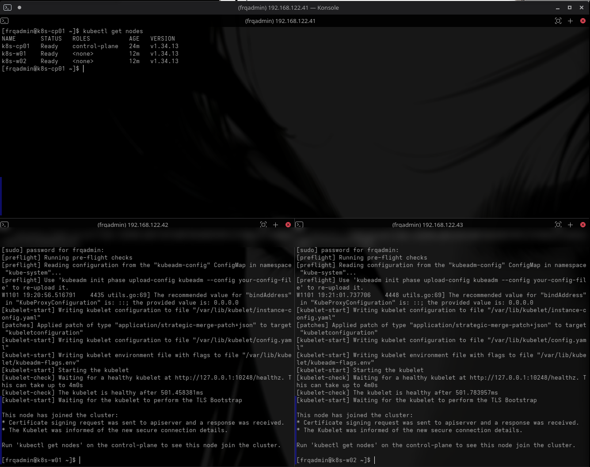

### Result: a working cluster

The workers showed `NotReady` for a few seconds, then switched to `Ready`. Flannel runs as a **DaemonSet** (one pod on *every* node), and each worker became Ready once its own Flannel pod started.

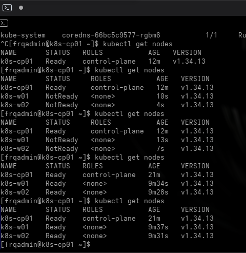

---

## 4. Part 2: Run an app on it

All commands from here on run on `k8s-cp01`.

### Deploy an app

```bash
kubectl create deployment web --image=nginx:1.27 --replicas=3
kubectl get pods -o wide
```

A **Deployment** says "keep 3 copies of nginx running." The **scheduler** decided where each one goes. Look at the `NODE` column:

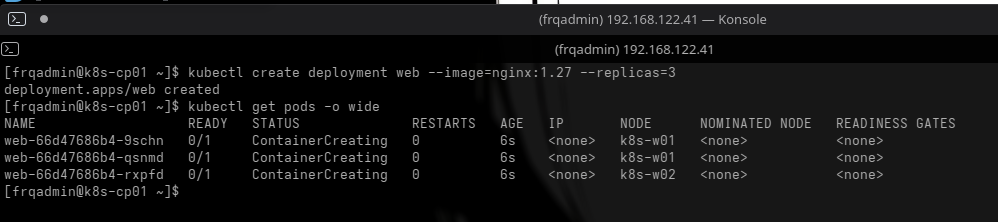

### Why nothing runs on the control plane

```bash
kubectl describe node k8s-cp01 | grep -i taint
```

The control plane has a **taint**: `node-role.kubernetes.io/control-plane:NoSchedule`. A taint is a "keep out" sign: normal pods aren't allowed to run there, so the control plane stays free to manage the cluster.

### Self-healing

```bash
kubectl delete pod <one-of-the-web-pods>
kubectl get pods -o wide -w
```

I deleted pod `9schn`. Within seconds, a new pod (`k2x22`) appeared. The Deployment wanted 3, saw 2, and created one more. **Nobody had to do anything.**

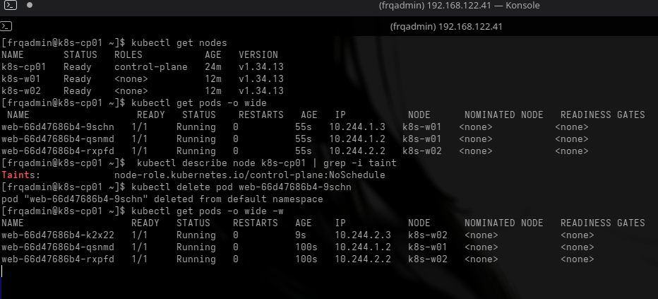

### Scaling and exposing the app

```bash
kubectl scale deployment web --replicas=6
kubectl get pods -o wide                     # spread across both workers

kubectl expose deployment web --port=80 --type=NodePort
kubectl get svc web
```

- **Scaling** is one command. The new pods got IPs `10.244.1.x` (on `k8s-w01`) and `10.244.2.x` (on `k8s-w02`).
- A **Service** gives the pods one stable address. Pods come and go, the Service stays.
- **NodePort** opens the same port (here `31418`) on **every** node, so you can reach the app from outside the cluster.

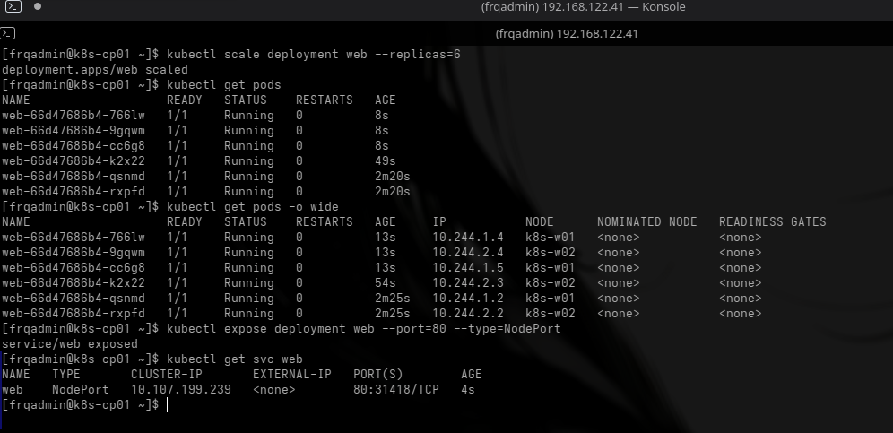

### Finding the app by name (DNS inside the cluster)

```bash
kubectl run tmp --rm -it --image=busybox:1.36 --restart=Never -- wget -qO- http://web
```

A temporary pod fetched `http://web` and got the nginx page back. Pods find Services **by name**, thanks to **CoreDNS**.

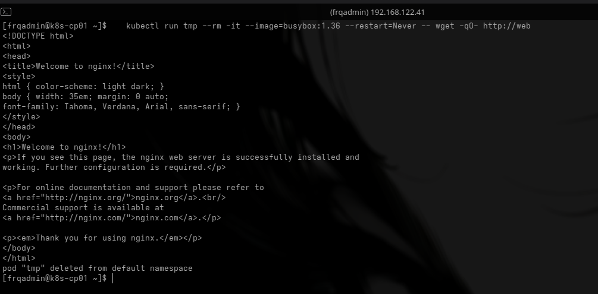

### Reaching the app from outside

Opening `http://192.168.122.41:31418` from the host machine showed the nginx page:

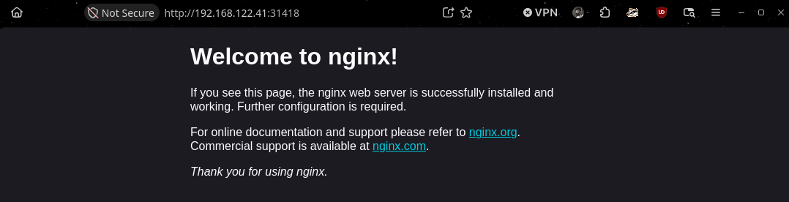

> **Interesting detail:** `192.168.122.41` is the **control plane**, which runs **no** web pods. It still worked because **kube-proxy** runs on every node and forwards NodePort traffic to a healthy pod wherever it is.

### Rolling update

```bash
kubectl set image deployment/web nginx=nginx:1.28
kubectl rollout status deployment/web
```

Kubernetes replaced the pods **a few at a time** ("3 out of 6 new replicas... 5 of 6..."). Old pods were only removed once new ones were ready, so the app **stayed up** during the update. The new pods have a different name prefix (`web-fbdc6fc8c-...`) because they belong to a new version of the Deployment.

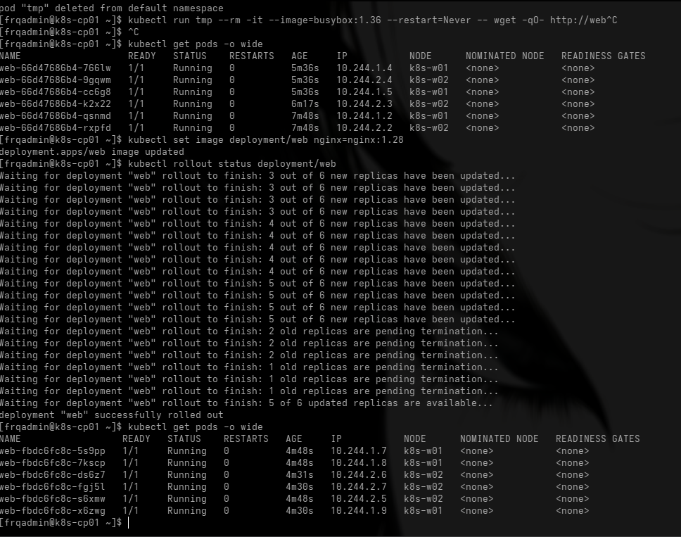

### Rollback

```bash
kubectl rollout undo deployment/web
kubectl rollout status deployment/web
kubectl describe deployment web | grep Image    # back to nginx:1.27
```

Going back to the previous version is **one command**.

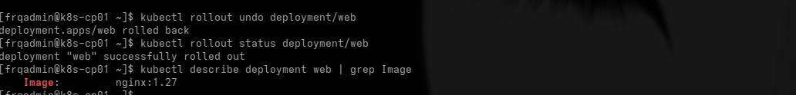

---

## 5. Part 3: Break it and fix it

The most useful skill in operations is reading the **status** of a broken pod and knowing where to look.

### How to investigate any broken pod

| Command | What it tells you |
|---|---|
| `kubectl get pods` | The **status** (what's wrong, in one word) |
| `kubectl describe pod <name>` | The **Events** section at the bottom explains *why* |
| `kubectl logs <name>` | What the app printed |
| `kubectl logs <name> --previous` | What the app printed **before it crashed** |

### Break 1: Bad image name (`ImagePullBackOff`)

```bash
kubectl set image deployment/web nginx=nginx:doesnotexist
kubectl get pods
kubectl describe pod <failing-pod-name> | tail -15
kubectl rollout undo deployment/web
```

- **Status:** `ErrImagePull`, then `ImagePullBackOff` (Kubernetes waits longer between each retry).
- **Events:** `failed to resolve image: docker.io/library/nginx:doesnotexist: not found`.
- **Important:** the **old pods kept running** while the new ones failed. A rolling update doesn't remove working pods until the new ones are healthy, so a bad deploy didn't take the app down.

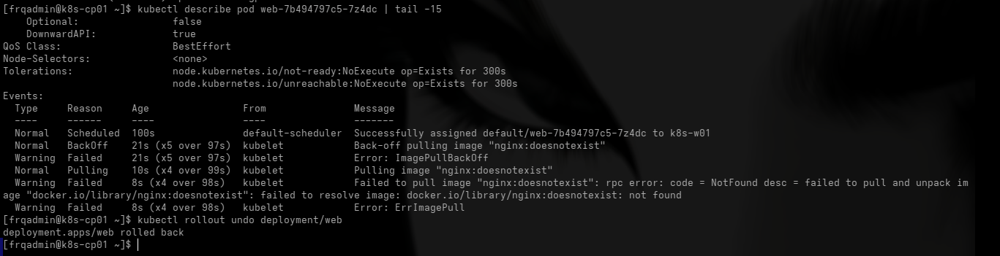

### Break 2: App crashes on start (`CrashLoopBackOff`)

```bash
kubectl run crashy --image=busybox:1.36 --restart=Always -- sh -c "echo starting; sleep 3; exit 1"
kubectl get pods -w
kubectl logs crashy --previous
kubectl delete pod crashy
```

- **Status:** `Running` → `Error` → `CrashLoopBackOff`, over and over, with the **RESTARTS** count going up.
- **Backoff:** Kubernetes waits longer between each restart (10s, 20s, 40s... up to 5 minutes) so a broken app doesn't hammer the node.
- **Where to look:** `kubectl logs --previous` shows the output of the attempt that crashed.

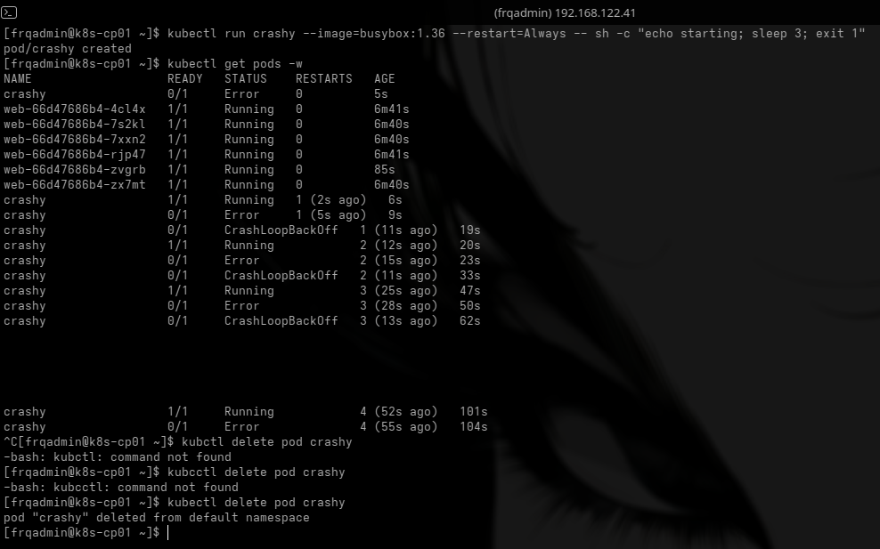

### Break 3: Asks for more than any node has (`Pending`)

```bash
kubectl run hungry --image=nginx:1.27 \
  --overrides='{"spec":{"containers":[{"name":"hungry","image":"nginx:1.27","resources":{"requests":{"cpu":"8"}}}]}}'
kubectl get pod hungry
kubectl describe pod hungry | tail -5
kubectl delete pod hungry
```

- **Status:** `Pending`. The pod was never placed on a node.
- **Events:** `0/3 nodes are available: 1 node(s) had untolerated taint(s), 2 Insufficient cpu.` In plain words: the control plane is off-limits (taint), and neither worker has 8 CPUs.
- **Key lesson:** a pod must fit on **one** node. It can't be split across machines, even if the cluster has enough CPU in total. (Unlike an LV, which *can* span several disks.)

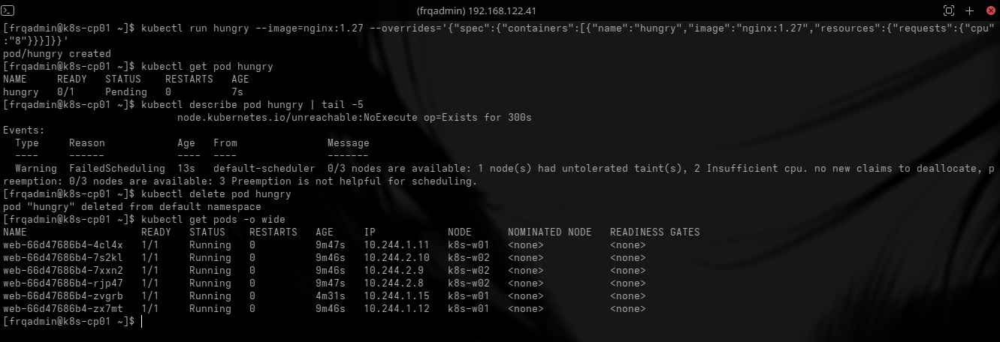

### Status cheat sheet

| Status | Meaning | First thing to check |
|---|---|---|
| `Pending` | Not placed on any node yet | `describe` → Events: resources, taints, scheduling rules |
| `ContainerCreating` | Placed, pulling image / starting | Wait, or `describe` if it's stuck |
| `ErrImagePull` / `ImagePullBackOff` | Can't download the image | Image name, tag, registry access |
| `CrashLoopBackOff` | Starts, then keeps crashing | `logs --previous` |
| `Running` | Container is up | Still check the app itself works |
| `OOMKilled` | Used more memory than its limit | Memory limits, memory leaks |

---

## 6. Part 4: Node maintenance

How do you patch or reboot a worker without breaking the app? **Cordon and drain.**

```bash
kubectl cordon k8s-w01      # 1. no new pods may be scheduled here
kubectl drain k8s-w01 --ignore-daemonsets --delete-emptydir-data   # 2. move pods off
kubectl get pods -o wide    # all web pods now on k8s-w02
kubectl get nodes           # k8s-w01: Ready,SchedulingDisabled
# ... patch / reboot the node here ...
kubectl uncordon k8s-w01    # 3. allow scheduling again
```

- **cordon:** marks the node "no new pods."
- **drain:** evicts the pods on it, and their Deployments recreate them on other nodes.
- **`--ignore-daemonsets`:** DaemonSet pods (Flannel, kube-proxy) belong on every node, so they stay.
- **uncordon:** puts the node back into service.

This is the Kubernetes version of a **rolling patch**: one node at a time, like `serial: 1` in an Ansible playbook.

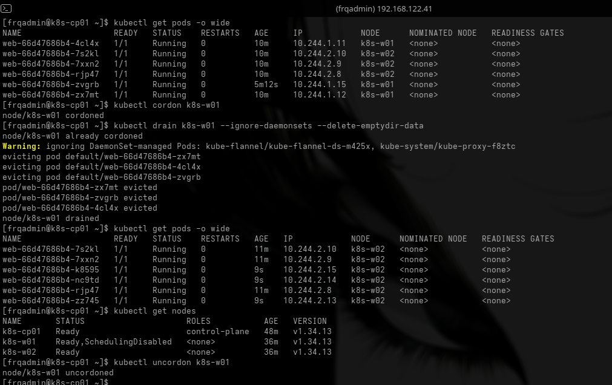

### Pods don't move back by themselves

After `uncordon`, **all six pods were still on `k8s-w02`**. Kubernetes doesn't rebalance existing pods on its own. `k8s-w01` will only get pods when new ones are created (scaling up, a rollout, or a pod dying).

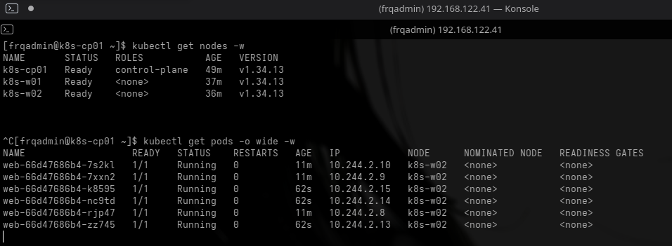

To spread them out again, trigger a fresh rollout:
```bash
kubectl rollout restart deployment/web
```

---

## 7. Problems I ran into

| Problem | Cause | Fix |
|---|---|---|
| SSH session froze while changing the IP | The IP I was connected to changed | Reconnect to the new IP, or use the VM console |
| `bash: syntax error near unexpected token '\|'` | I typed a placeholder like `<pod-name>` literally. Bash reads `<` as input redirection | Replace placeholders with the real pod name |
| Nodes `NotReady` right after joining | Flannel hadn't started on them yet | Wait until the Flannel pod on each node is Running |
| CoreDNS stuck `Pending` | No pod network yet | Install the CNI (Flannel) |
| Old IPs in `/etc/hosts` after switching to static IPs | Earlier DHCP addresses | Remove old lines, keep one entry per node |

---

## 8. Lab shortcuts vs production

This lab cuts corners to keep things simple. In a real environment:

| Lab | Production |
|---|---|
| SELinux **permissive** | **Enforcing**, with the right SELinux policies for the container runtime |
| firewalld **disabled** | Open only the required ports (control plane: 6443, 2379-2380, 10250, 10257, 10259 · workers: 10250, 30000-32767 · Flannel VXLAN: 8472/udp) |
| **1** control plane | **3** control plane nodes for high availability, behind a load balancer |
| etcd on one node | Regular **etcd backups** (it holds the whole cluster state) |
| Built by hand | Automated with **Ansible** / **Kubespray**, or a managed service like **AWS EKS** |
| Apps created with `kubectl create` | Apps defined in **YAML in Git**, deployed with **GitOps** (Argo CD) |
| NodePort | An **Ingress** or a cloud **LoadBalancer** Service |

---

## 9. Command cheat sheet

```bash
# Cluster
kubectl get nodes -o wide
kubectl get pods -A                         # everything, all namespaces
kubectl describe node <node>

# Apps
kubectl create deployment web --image=nginx:1.27 --replicas=3
kubectl scale deployment web --replicas=6
kubectl expose deployment web --port=80 --type=NodePort
kubectl get pods -o wide
kubectl get svc

# Updates
kubectl set image deployment/web nginx=nginx:1.28
kubectl rollout status deployment/web
kubectl rollout history deployment/web
kubectl rollout undo deployment/web
kubectl rollout restart deployment/web

# Troubleshooting
kubectl describe pod <pod>                  # read the Events at the bottom
kubectl logs <pod>
kubectl logs <pod> --previous
kubectl get events --sort-by=.lastTimestamp

# Maintenance
kubectl cordon <node>
kubectl drain <node> --ignore-daemonsets --delete-emptydir-data
kubectl uncordon <node>

# Node join
kubeadm token create --print-join-command   # on the control plane
```

---

## 10. What's next

- [ ] Turn Part 1 into **Ansible roles** (`k8s_node_prep`, `k8s_control_plane`, `k8s_worker_join`)
- [ ] Write the app as **YAML** (`kubectl apply -f`) instead of `kubectl create`
- [ ] Install **Argo CD** and deploy the app from a Git repo (GitOps)
- [ ] Package the app with **Helm**
- [ ] Add **persistent storage** (PersistentVolumes / PVCs)
- [ ] Build the same thing on **AWS EKS** with Terraform

## Clean up

```bash
# On each node, to remove Kubernetes
sudo kubeadm reset -f
# Or simply delete / revert the VMs
```
